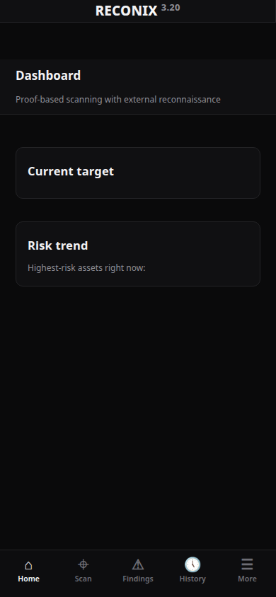
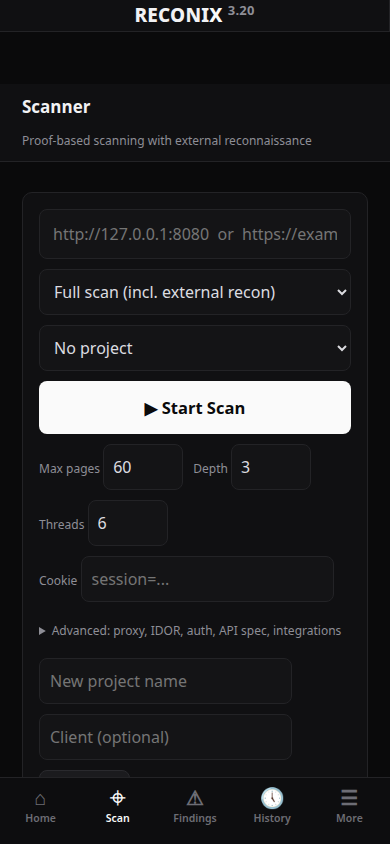

  

<h1 align="center">Reconix for Android</h1>

  A proof-based web vulnerability scanner and attack-surface mapper that runs
  <b>fully standalone on your phone</b> — no server, no Termux, no account.

---

## What it does

Reconix performs authorized security assessments of web applications and
external attack surface:

- **Vulnerability scanning** — SQL injection, XSS, SSRF, IDOR, auth bypass,
  security headers, CORS, TLS, and 50+ more check classes, each finding
  delivered with **proof**, not just a claim
- **External reconnaissance** — subdomains, DNS & email security (SPF / DMARC /
  DKIM), certificates, cloud exposure, technology fingerprinting
- **Attack surface inventory** — every asset found, tracked across scans
- **Plain-language findings** — every result answers *What is it? Where is it?
  Why does it matter? What can be done with it? How do I fix it?*
- **Reports** — export HTML, JSON, CSV, PDF, DOCX and HAR, straight to the
  phone's Downloads folder
- **Compare & retest** — diff two scans to see what changed, and one-tap
  Verify-Fix retests that replay each finding against the live target
- **Extras** — HTTP repeater, 403-bypass tester, scheduled scans

The engine is benchmarked at **100% detection recall with 0 false positives**
on its built-in test range.

## Screenshots

  
  &nbsp;&nbsp;
  

## Install

1. Go to [**Releases**](../../releases) and download the latest
   `Reconix-vX.Y.apk`.
2. (Recommended) Verify the file before installing — the release page lists
   the SHA-256 checksum, and the file is **~30.3 MB**. A different size means
   a corrupted download; fetch it again.
3. Open the APK on your phone and allow *Install from this source* when
   Android asks. Android 7.0+ is supported.
4. Open Reconix, type a target you are authorized to test, and scan.

Everything runs on-device: the scanner engine, its Python runtime and the UI
are all inside the APK. Scan data never leaves the phone.

## ⚠️ Authorized use only

Reconix is a professional security-assessment tool. **Only scan systems you
own or are explicitly authorized to test** (a signed engagement, a bug-bounty
program's scope, your own infrastructure). Unauthorized scanning may be
illegal in your jurisdiction. The author accepts no responsibility for misuse.

## About this repository

This is the official **release repository** for the Reconix Android app:
binaries, checksums, screenshots and release notes. The scanner's source code
is developed privately and is not published here.

## Current release

**v1.4** (engine 3.20) — see the [Releases](../../releases) page for the APK
and full notes.

---

<i>RECONIX — Discover · Scan · Secure</i>

